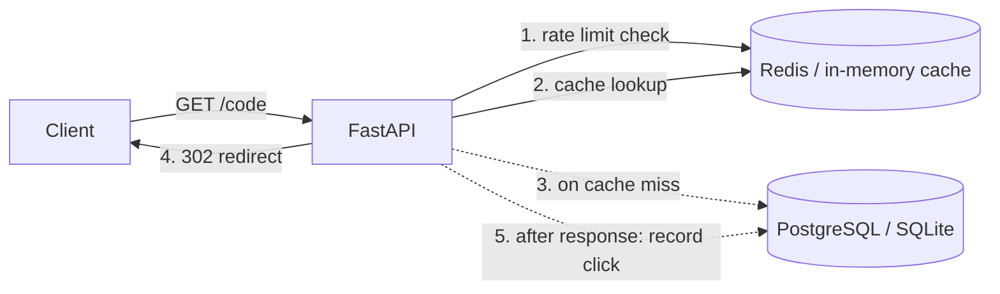

# URL Shortener with Analytics

A URL shortener built with **FastAPI**, with JWT auth, Redis caching, rate limiting and click analytics (referrers, browsers, devices, countries, clicks per day).

Runs with zero setup (SQLite + in-memory cache). In production it uses **PostgreSQL + Redis** via two environment variables.

## Architecture



**Redirect path:** rate-limit check, then cache lookup. On a miss there is one indexed DB query and the result is cached. The click is recorded in a background task *after* the response is sent, so analytics never slow down the redirect.

## Features

- Create short links with random Base62 codes or custom aliases
- Optional link expiry (enforced exactly, even for cached links)
- Per-user link management (list, inspect, delete) with JWT auth
- Analytics per link: total clicks, clicks per day, top referrers, browsers, devices, countries
- Fixed-window rate limiting per client IP (separate limits for redirects and link creation)
- Input validation: only `http(s)` URLs, reserved aliases blocked, self-referencing links rejected

## Quick start

```bash
python3 -m venv .venv && source .venv/bin/activate
pip install -r requirements-dev.txt
uvicorn app.main:app --reload
```

Open http://localhost:8000/docs for the interactive API docs.

### Full stack with Docker (Postgres + Redis)

```bash
export SECRET_KEY=$(openssl rand -hex 32)
docker compose up --build
```

### Deploy to Render

The repo includes a [`render.yaml`](render.yaml) Blueprint. In the Render dashboard choose **New → Blueprint**, select this repo, and it provisions the API (Docker), a Postgres database and a Redis-compatible Key Value store, all on free plans. `SECRET_KEY` is generated for you and the public URL is detected automatically.

## API

| Method | Path | Auth | Description |
|---|---|---|---|
| POST | `/api/auth/register` | no | Create an account |
| POST | `/api/auth/login` | no | Get a JWT |
| POST | `/api/links` | yes | Create a short link (`url`, optional `custom_alias`, `expires_at`) |
| GET | `/api/links` | yes | List your links (paginated) |
| GET | `/api/links/{code}` | yes | Get one link |
| DELETE | `/api/links/{code}` | yes | Delete a link and its clicks |
| GET | `/api/links/{code}/analytics?days=30` | yes | Click analytics |
| GET | `/{code}` | no | Redirect (302) |

## Design decisions

| Decision | Why | Trade-off |
|---|---|---|
| Random Base62 codes (7 chars, ~3.5T combinations) | Codes can't be enumerated; no coupling to DB row IDs | Needs a uniqueness check; retry on collision, with the DB `UNIQUE` constraint as the final guard |
| 302 instead of 301 | Browsers cache 301s permanently, which would hide repeat clicks from analytics | Slightly more load than a cacheable redirect |
| Click recording in a background task | Redirect latency doesn't include a DB write | A crash between response and write loses that click |
| Expiry checked on every request, even cache hits | Expiry is exact, not delayed by cache TTL | One timestamp comparison per request |
| Cache TTL capped at the link's remaining lifetime | A cached entry never outlives the link | - |
| Fixed-window rate limiting | One `INCR` per request, simple | Up to 2x burst across a window boundary; sliding window or token bucket would fix it |
| 404 (not 403) for other users' links | Link codes can't be probed | - |
| Only the referrer **host** is stored | Avoids storing tokens or PII from full referrer URLs | Less detail |
| Cache layer behind one interface (Redis or in-memory) | Same code runs locally and in production | In-memory cache and rate limits are per-process; use Redis with more than one worker |

## Tests

```bash
pytest -q
```

31 tests covering auth, link creation and validation, ownership isolation, redirects, cache behaviour and invalidation, expiry, rate limiting and analytics aggregation. CI also runs the suite against real Postgres and Redis (see `.github/workflows/ci.yml`).

## Load test

```bash
REDIRECT_RATE_LIMIT=10000000 CREATE_RATE_LIMIT=10000000 uvicorn app.main:app --port 8000
locust -f locustfile.py --host http://localhost:8000 --headless -u 50 -r 50 -t 15s
```

Measured on a MacBook Air with **one uvicorn worker, SQLite (WAL mode) and the in-process cache**, with Locust running on the same machine (50 users, 95% redirects / 5% link creation, 3 runs):

| Metric | Result |
|---|---|
| Redirect throughput | ~690-750 req/s |
| Redirect latency | p50 3-5 ms, p95 9-42 ms, p99 18-71 ms |
| Failures | 0 |

These are laptop numbers for a single process, not a production benchmark. The Postgres + Redis stack with several workers has not been benchmarked yet.

## Known limitations / roadmap

- [ ] Alembic migrations (tables are currently created at startup; with multiple workers on a fresh Postgres DB this can race)
- [ ] Batch click writes (buffer in memory or Redis, bulk insert) instead of one insert per click
- [ ] GeoIP lookup (country currently comes from a proxy header such as Cloudflare's `CF-IPCountry`)
- [ ] Sliding-window rate limiter
- [ ] Simple frontend dashboard for analytics charts
